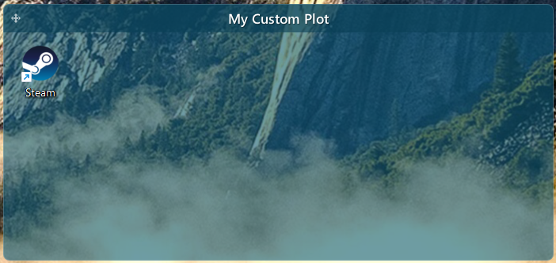
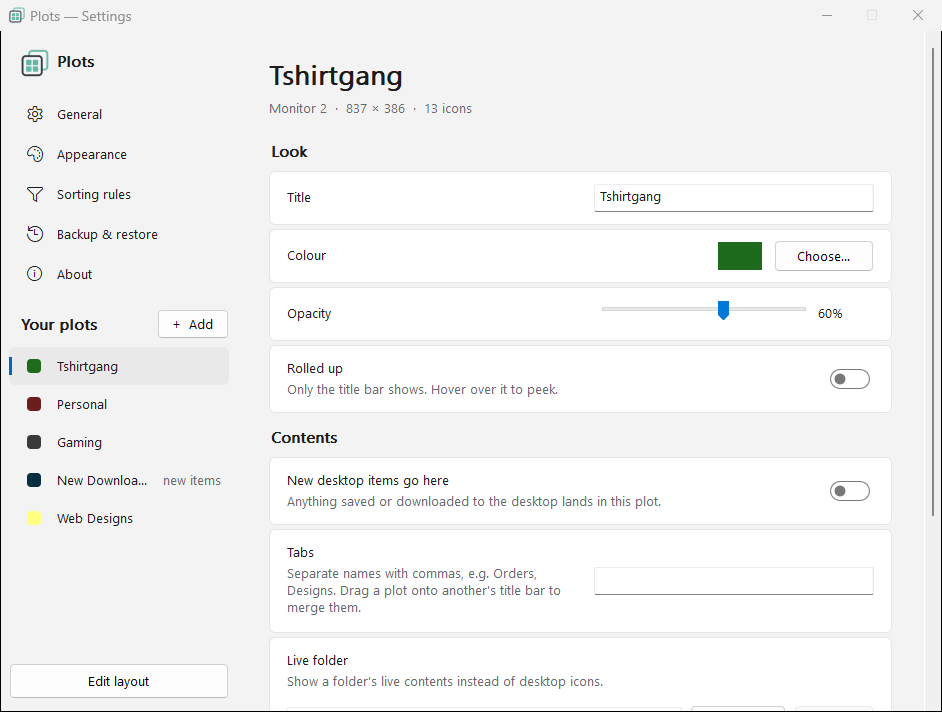
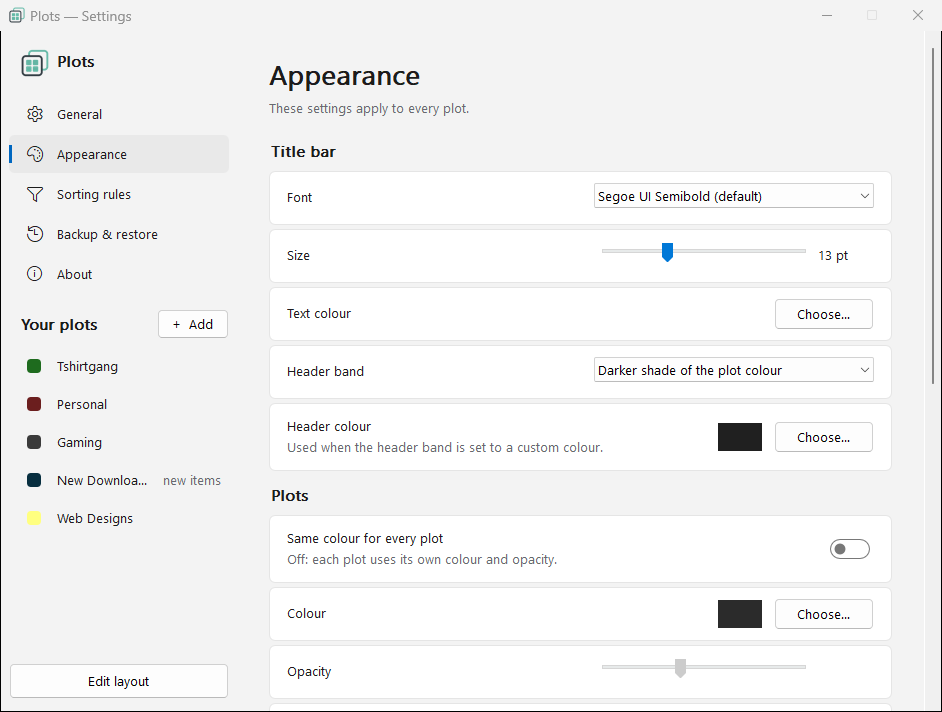
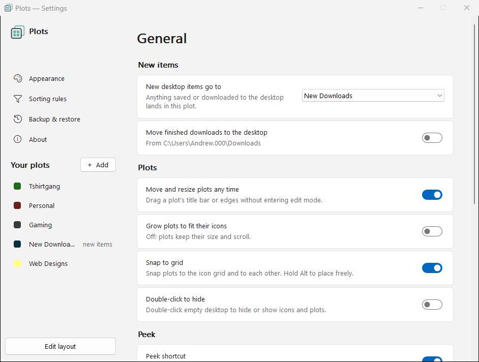
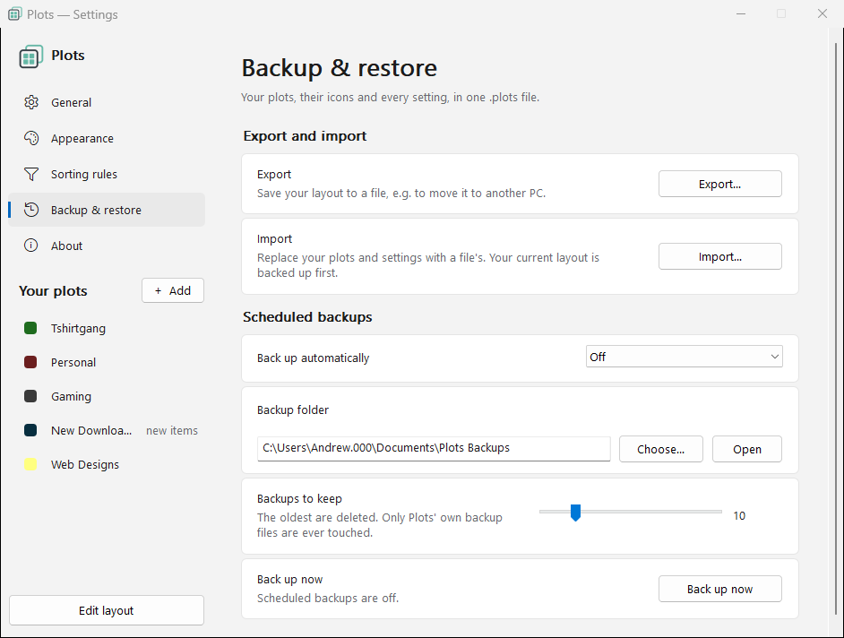
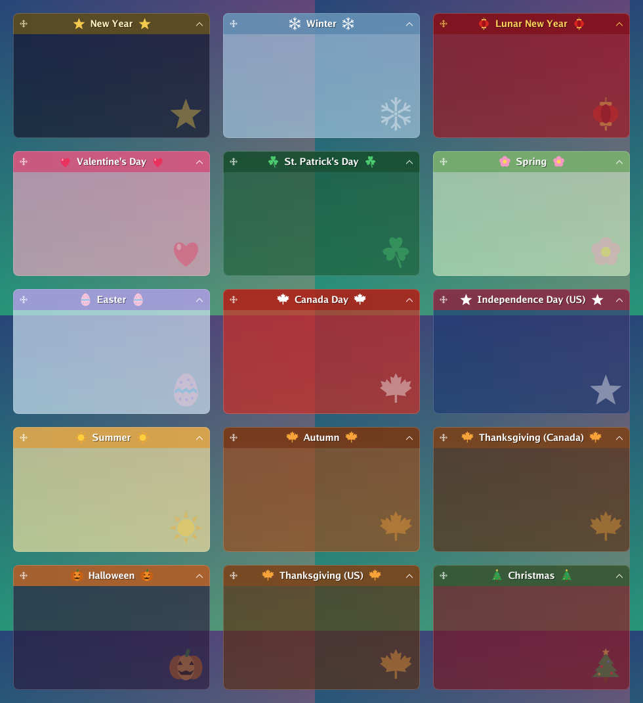
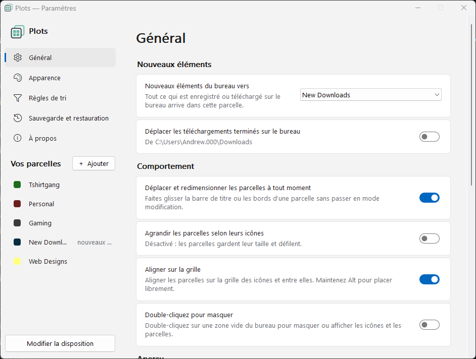

# Plots — desktop groups for Windows

A lightweight Stardock Fences–style organizer. Single `Plots.exe`, no installer, no runtime.


<p align="center">
  <br>
  <em>A plot on the desktop: icons snap into a translucent panel that blends with your wallpaper.</em>
</p>

## Settings

<table>
  <tr>
    <td></td>
    <td></td>
  </tr>
  <tr>
    <td align="center"><em>Each plot: look, tabs, live folder and icon size</em></td>
    <td align="center"><em>Appearance for every plot</em></td>
  </tr>
  <tr>
    <td></td>
    <td></td>
  </tr>
  <tr>
    <td align="center"><em>General: new items, snapping, Peek shortcut</em></td>
    <td align="center"><em>Export, import and scheduled backups</em></td>
  </tr>
</table>

## Features
- **Plots:** translucent panels on the desktop that hold your icons. Set the title, colour, opacity and rounded corners for each one.
- **Drag and drop:** drop an icon into a plot and it snaps into the grid and stays there. Icons auto-align with adjustable padding.
- **Real desktop icons:** icons stay normal Explorer icons. New, renamed and deleted files show up straight away, and Plots recovers after Explorer restarts.
- **Inbox plot:** pick one plot and every new item saved to the desktop lands in it automatically. Plots can also move finished downloads to the desktop.
- **Sorting rules:** send files to a plot by type (images, documents, installers, archives and more).
- **Tabs:** split one plot into two or more tabs of equal width. Drag a plot onto another's title bar to merge them into tabs, drag a tab to reorder it, or drag it out onto the desktop to make it a plot of its own.
- **Roll up:** collapse a plot to its title bar with the chevron, or by double-clicking the title. Hovering a rolled-up plot shows its contents.
- **Scrolling:** plots with more icons than fit scroll with the mouse wheel, or can grow to fit instead.
- **Live folders:** a plot can show the contents of any folder, with thumbnails, sorting, its own icon size, optional icon tinting and the normal Explorer right-click menu.
- **Fade until hover:** plots, and optionally the desktop icons, rest faded into the wallpaper and come into focus when the mouse is over them.
- **Peek:** a shortcut you choose (Ctrl+Alt+P by default) shows every plot above your windows over a dimmed screen. Double-click an icon to open it. Press the shortcut again, or Esc, to hide them.
- **Backup and restore:** export your whole layout to a `.plots` file, import it on another PC, and keep daily, weekly or monthly backups in a folder you pick.
- **Move and resize anytime:** drag a plot by its title bar or edges, with snap to grid and fine control near screen edges. There's also a full edit mode.
- **Multi-monitor:** every plot remembers its monitor and follows each monitor's DPI scale.
- **Global look:** one header style, font, font size and colour for every plot, or set each plot on its own. Desktop icon size can be changed from Settings too.
- **Double-click to hide** (optional): hide or show all icons and plots by double-clicking empty desktop.
- **Right-click menus** on plot title bars, and a tray icon for quick access.
- **Starts fast** with Windows, and the desktop check interval is adjustable from 0.1 to 0.5 s.
- **Updates itself:** checks GitHub Releases from the About page or automatically, then updates in place. Every update is signed, and Plots refuses one that isn't.
- **8 languages:** English, Français, Español, Português (Brasil), Deutsch, 中文（简体）, 日本語 and Русский. Plots follows your Windows language, or pick one under **General › Language**.
- **Seasonal themes:** Halloween, Christmas, Valentine's Day, St. Patrick's Day, Easter, Lunar New Year, Canada Day, the 4th of July, both Thanksgivings, New Year and the four seasons. Each recolours the plots and adds small drawn decorations. Pick which holidays show automatically, always use one, or keep your colours and add only the decorations.
- **Background images:** give any plot a picture behind its icons, filled, fitted, stretched or tiled, with its own opacity.
- **Lock a plot** so it can't be moved, resized, merged or split by accident (right-click its title bar, or in Settings).
- **Small and portable:** one `Plots.exe`, no installer, no runtime. Every release is security-scanned before it's published.

## Seasonal themes

<p align="center">
  <br>
  <em>Turn them on under <strong>Settings › Seasonal themes</strong>. Automatic shows each holiday for a week or two before the day.</em>
</p>

## Languages

<p align="center">
  <br>
  <em>Plots in French. It follows your Windows display language automatically.</em>
</p>

Plots is translated into French, Spanish, Brazilian Portuguese, German, Simplified Chinese, Japanese and Russian. The translations are machine-assisted, so corrections from native speakers are very welcome: each language is one file in [`lang/`](lang/), and [lang/README.md](lang/README.md) explains how to fix a string or add a language.

## Run it
Download `Plots.exe` from the [latest release](https://github.com/phpandrew/Plots/releases/latest). There's nothing to install.

**First run:** Plots isn't code-signed, so Windows may show *"Windows protected your PC"*. Click **More info**, then **Run anyway**. Windows only asks once per download. Every release is built from this repository by GitHub Actions and security-scanned before it's published ([how](docs/SECURITY-FLOW.md)).

1. **Quit Fences first.** Both apps move the same desktop icons and will fight each other.
2. Double-click `Plots.exe`. The Plots icon appears in the tray.
3. First run opens **edit mode** with one plot.

## Edit mode
Open it from the tray menu (**Edit plots**), from a plot's right-click menu, or with **Edit layout** in Settings.
- Drag a plot to move it. Drag its edges to resize it.
- Double-click a plot to rename it. Right-click it for colour, opacity, the inbox setting and delete.
- **+ New plot** adds as many plots as you want, on any monitor.
- Click **Done** to save. Icons already sitting under a plot join it.

## Everyday use
- Drag any desktop icon into a plot and it snaps into the plot's grid. Drag it out and it stays where you drop it.
- Drag an icon onto another spot in the same plot to reorder.
- Right-click a plot's **title bar** to open the Plots menu. Right-clicking anywhere else still gives the normal Explorer menu.
- A plot grows taller if it holds more icons than fit.
- **Inbox plot:** pick one plot under *New items & downloads go to this plot*. Any new item that Windows places on the desktop goes there: downloads, saved files, and anything created while Plots was closed. It's marked with a ⤓ arrow. Files you drag onto a specific plot from Explorer, or create there with right-click › New, stay where you dropped them.
- **Move new files from Downloads to the desktop** (optional): when your browser finishes a download, Plots moves it to the desktop so it lands in the inbox. Partial downloads (`.crdownload`, `.part`, …) are ignored.
- **Double-click to hide** (optional, off by default): double-click empty desktop to hide or show all icons and plots. You can also use the tray menu.

## Why it keeps up when Fences doesn't
Plots doesn't keep its own copy of your icons. They stay as real Explorer desktop icons. Plots checks them about twice a second through the documented shell interfaces (`IFolderView`) and fixes any icon that is out of place. That covers new files, renamed files, deletions, Explorer restarts, monitor changes and DPI changes. A file that briefly disappears keeps its plot. A file is only removed from its plot after it's really gone from disk.

## Multi-monitor
Each plot remembers the monitor it's on, by device name, and its position on that monitor. If you unplug that monitor, the plot moves onto the primary monitor until you plug it back in. Sizes follow each monitor's DPI scale.

## Settings and files
- Settings window: open it from the tray icon (single click), or with **Settings…** in any menu.
- Config: `%APPDATA%\Plots\config.json`. Log: `%APPDATA%\Plots\plots.log`.
- Plots turns off Explorer's *Auto arrange icons* and *Align icons to grid*. You can turn this off in Settings, but plots may then look misaligned.

## Uninstalling
Turn off **Start with Windows** in Settings › General, choose **Exit Plots** from the tray icon, then delete `Plots.exe` and `%APPDATA%\Plots`. Your icons stay on the desktop.

## Building
**Version:** the `VERSION` file holds the version (e.g. `0.2.2`). Bump it when you want a new number. If you push without bumping, CI uses the next free patch number (`0.2.3`, …), so builds never collide.

**GitHub Actions** (`.github/workflows/build.yml`) builds Plots on every push to `main` and, once the security scans pass, publishes a GitHub Release `v<VERSION>`, marked **Latest**, with `Plots.exe`, `Plots-update.exe` and its signature `Plots-update.exe.sig` attached. Drop both update files next to a running Plots and it updates itself; Plots also checks Releases on its own. Updates must be signed with the release key or Plots won't install them ([how](docs/UPDATE-SIGNING.md)). Pull requests only build and test.

**Local build** (`build.bat` does this on Windows): it stamps `<VERSION>-dev`, so a later GitHub release of the same number counts as newer:
```
go build -trimpath -ldflags "-s -w -H windowsgui -X main.version=0.2.2-dev" -o Plots.exe .
```

`.exe` files are git-ignored.
On Linux or macOS, add `GOOS=windows GOARCH=amd64`. Requires Go 1.26+.

The icon, manifest and version info live in `rsrc_windows_*.syso`; keep those committed. To regenerate them after changing `winres/`, run `go run github.com/tc-hib/go-winres@latest make --in winres/winres.json`.

Platform-independent logic (`engine.go`, `render.go`, `config.go`, `wallpaper.go`) has unit tests: `go test ./...`.

## Security
Every push to `main` is scanned with **govulncheck** and **CodeQL** before it's released. A finding holds the release back and opens a `security` issue, which closes itself once a scan is clean. The scans also run daily and on pull requests. Details: [docs/SECURITY-FLOW.md](docs/SECURITY-FLOW.md). To report a vulnerability, see [SECURITY.md](.github/SECURITY.md).
- **Dependabot** (`.github/dependabot.yml`) opens grouped pull requests every Monday for Go modules and GitHub Actions.
- **Signed updates:** each release's update is signed with an Ed25519 key held only as a GitHub secret. Plots checks the signature, the file's SHA-256 and that the version is newer before installing, so a tampered download, a file dropped next to `Plots.exe` or an old release can't be installed. Release notes list the SHA-256 of `Plots.exe`. Details: [docs/UPDATE-SIGNING.md](docs/UPDATE-SIGNING.md).
- **Imported layouts** can't point the downloads mover at another folder or open network folders; Plots lists a file's live folders before you import it.
- Builds always use the newest Go 1.26 patch release, so standard-library security fixes are picked up automatically.

## Privacy
Plots sends nothing about you or your PC anywhere. Its only network use is checking GitHub for new versions of Plots, which you can turn off under Settings › About. Details: [docs/PRIVACY.md](docs/PRIVACY.md).

## License
[MIT](LICENSE) © Andrew Lyle

## Layout of the code
| File | What it does |
|---|---|
| `engine.go` | Assignment, drag detection, ordering, inbox, rename tracking, grid layout (pure Go, tested) |
| `render.go` | Draws plot panels: rounded translucent body, title band, title text |
| `config.go` | Config model, load/save |
| `shellview_windows.go` | COM: desktop `IFolderView` (read and move icons, turn off auto-arrange) |
| `desktop_windows.go` | Finds the layer behind the icons (WorkerW / Progman, including the 24H2 layout), monitors |
| `app_windows.go` | Main loop, tick, panels on the desktop layer, hide/show |
| `edit_windows.go` | Edit-mode overlays (move/resize), toolbar, new/delete plot |
| `settings_windows.go` | Settings window |
| `tray_windows.go` | Tray icon, tray menu, plot right-click menu, colour picker |
| `hook_windows.go` | Low-level mouse hook on its own thread (title right-click, double-click hide, drop hints) |
| `downloads_windows.go` | Downloads → desktop mover, start with Windows |
| `panels_windows.go` | Draws plot panels on the desktop layer, behind the icons |
| `wallpaper.go`, `wallpaper_windows.go` | Blends each panel with the wallpaper underneath it so it looks see-through |
| `watcher_windows.go` | Watches the desktop folders and refreshes Explorer when it misses a change |
| `fonts_windows.go` | Lists installed fonts for the Appearance page |
| `.github/workflows/build.yml` | CI: test, vet, build `Plots.exe`, run the scans, publish a release on every clean push to `main` |
| `.github/workflows/security.yml`, `.github/scripts/security-report.sh` | govulncheck and CodeQL; opens and closes `security` issues |
| `.github/dependabot.yml` | Dependabot update PRs |
| `about_windows.go`, `update.go` | About page, GitHub links, update check / download from GitHub Releases |
| `plotmodel.go` | Tabs, sorting rules and their presets, merging plots and splitting tabs |
| `backup.go`, `backup_windows.go` | Export / import of `.plots` layouts, scheduled backups |
| `peek_windows.go`, `peekview_windows.go` | The Peek shortcut and the plots it shows above your windows |
| `seasons.go`, `seasons_windows.go`, `ornaments.go` | Seasonal themes: dates, colours and the drawn decorations |
| `bgimage.go` | Plot background images: loading, caching and layout |
| `iconfade_windows.go` | Fades the desktop icons with the plots |
| `i18n.go`, `i18n_windows.go`, `lang/*.json` | Translations: `T("English text")` looks the text up in the current language |
| `update.go`, `updatekey.go`, `internal/updatesig/`, `tools/sign/` | Signed updates: checking them in Plots, and making the key and signatures |
| `snapshot_windows.go` | Saves PNGs of the settings pages (create `snap.request` next to `config.json`; add `lang=fr` for another language) for docs |
