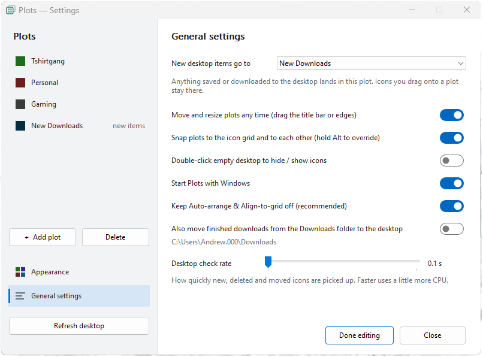

# Plots — desktop groups for Windows

A lightweight Stardock Fences–style organizer. Single `Plots.exe`, no installer, no runtime.


<p align="center">
  <br>
  <em>A plot on the desktop: icons snap into a translucent panel that blends with your wallpaper.</em>
</p>

<p align="center">
  <br>
  <em>Settings: plots in the sidebar, with Appearance and General settings pages.</em>
</p>

## Run it
1. **Quit Fences first.** Both apps move the same desktop icons and will fight each other.
2. Double-click `Plots.exe`. The Plots icon appears in the tray.
3. First run opens **edit mode** with one plot.

## Edit mode
Open it from the tray menu (**Edit plots**), from a plot's right-click menu, or with **Edit layout** in Settings.
- Drag a plot to move it. Drag its edges to resize it.
- Double-click a plot to rename it. Right-click it for colour, opacity, the inbox setting and delete.
- **+ New plot** adds as many plots as you want, on any monitor.
- Click **Done** to save. Icons already sitting under a plot join it.

## Everyday use
- Drag any desktop icon into a plot and it snaps into the plot's grid. Drag it out and it stays where you drop it.
- Drag an icon onto another spot in the same plot to reorder.
- Right-click a plot's **title bar** to open the Plots menu. Right-clicking anywhere else still gives the normal Explorer menu.
- A plot grows taller if it holds more icons than fit.
- **Inbox plot:** pick one plot under *New items & downloads go to this plot*. Any new item that Windows places on the desktop goes there: downloads, saved files, and anything created while Plots was closed. It's marked with a ⤓ arrow. Files you drag onto a specific plot from Explorer, or create there with right-click › New, stay where you dropped them.
- **Move new files from Downloads to the desktop** (optional): when your browser finishes a download, Plots moves it to the desktop so it lands in the inbox. Partial downloads (`.crdownload`, `.part`, …) are ignored.
- **Double-click to hide** (optional, off by default): double-click empty desktop to hide or show all icons and plots. You can also use the tray menu.

## Why it keeps up when Fences doesn't
Plots doesn't keep its own copy of your icons. They stay as real Explorer desktop icons. Plots checks them about twice a second through the documented shell interfaces (`IFolderView`) and fixes any icon that is out of place. That covers new files, renamed files, deletions, Explorer restarts, monitor changes and DPI changes. A file that briefly disappears keeps its plot. A file is only removed from its plot after it's really gone from disk.

## Multi-monitor
Each plot remembers the monitor it's on, by device name, and its position on that monitor. If you unplug that monitor, the plot moves onto the primary monitor until you plug it back in. Sizes follow each monitor's DPI scale.

## Settings and files
- Settings window: open it from the tray icon (single click), or with **Settings…** in any menu.
- Config: `%APPDATA%\Plots\config.json`. Log: `%APPDATA%\Plots\plots.log`.
- Plots turns off Explorer's *Auto arrange icons* and *Align icons to grid*. You can turn this off in Settings, but plots may then look misaligned.

## Building
**GitHub Actions** (`.github/workflows/build.yml`) builds `Plots.exe` on every push to `main` and every pull request. Find it under **Actions › the run › Artifacts** as `Plots-dev-<commit>`. That zip has both `Plots.exe` and `Plots-update.exe`; drop `Plots-update.exe` next to a running Plots and it updates itself.

To publish a release, push a version tag:
```
git tag v1.0.0
git push origin v1.0.0
```
The workflow attaches `Plots.exe` to a GitHub Release for that tag, with notes generated automatically. The version shows in `%APPDATA%\Plots\plots.log`.

`.exe` files are git-ignored. Builds come from CI, or from building locally:
```
go build -trimpath -ldflags "-s -w -H windowsgui" -o Plots.exe .
```
On Linux or macOS, add `GOOS=windows GOARCH=amd64`. Requires Go 1.26+.

The icon, manifest and version info live in `rsrc_windows_*.syso`; keep those committed. To regenerate them after changing `winres/`, run `go run github.com/tc-hib/go-winres@latest make --in winres/winres.json`.

Platform-independent logic (`engine.go`, `render.go`, `config.go`, `wallpaper.go`) has unit tests: `go test ./...`.

## Layout of the code
| File | What it does |
|---|---|
| `engine.go` | Assignment, drag detection, ordering, inbox, rename tracking, grid layout (pure Go, tested) |
| `render.go` | Draws plot panels: rounded translucent body, title band, title text |
| `config.go` | Config model, load/save |
| `shellview_windows.go` | COM: desktop `IFolderView` (read and move icons, turn off auto-arrange) |
| `desktop_windows.go` | Finds the layer behind the icons (WorkerW / Progman, including the 24H2 layout), monitors |
| `app_windows.go` | Main loop, tick, panels on the desktop layer, hide/show |
| `edit_windows.go` | Edit-mode overlays (move/resize), toolbar, new/delete plot |
| `settings_windows.go` | Settings window |
| `tray_windows.go` | Tray icon, tray menu, plot right-click menu, colour picker |
| `hook_windows.go` | Low-level mouse hook on its own thread (title right-click, double-click hide, drop hints) |
| `downloads_windows.go` | Downloads → desktop mover, start with Windows |
| `panels_windows.go` | Draws plot panels on the desktop layer, behind the icons |
| `wallpaper.go`, `wallpaper_windows.go` | Blends each panel with the wallpaper underneath it so it looks see-through |
| `watcher_windows.go` | Watches the desktop folders and refreshes Explorer when it misses a change |
| `fonts_windows.go` | Lists installed fonts for the Appearance page |
| `.github/workflows/build.yml` | CI: test, vet, build `Plots.exe`, attach it to a release on `v*` tags |
