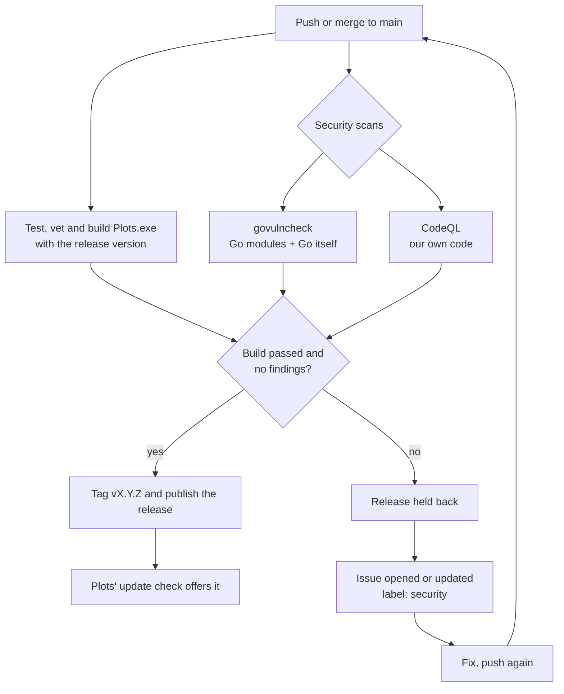

# Security flow: scan before release

Every change to `main` is scanned before it can be released. If a scan finds something, the release is held back and an issue is opened. Once a later scan is clean, the issue closes itself and the next push releases normally.



## The pieces

| File | Job |
|---|---|
| `.github/workflows/build.yml` (**Build**) | Tests and builds the exe, calls the security scans, publishes the release only if both pass |
| `.github/workflows/security.yml` (**Security**) | The scans. Called by Build before a release; also runs daily and on pull requests |
| `.github/scripts/security-report.sh` | Turns scan results into GitHub issues and decides pass or fail |
| `.github/dependabot.yml` | Weekly pull requests for dependency updates (Go modules, GitHub Actions) |
| `.github/SECURITY.md` | How people report a vulnerability privately |

## The scanners

| Scanner | Finds | Fix |
|---|---|---|
| **govulncheck** | Known CVEs in Go modules and the Go standard library, **only where Plots actually calls the vulnerable function**, so there's very little noise. Scans as Windows, the platform we ship. | Module: `go get <module>@<fixed> && go mod tidy`. Go itself: CI always uses the newest Go 1.26 patch, so a re-run usually fixes it; otherwise raise the `go` line in `go.mod`. |
| **CodeQL** | Bugs in our code: injection, path traversal, unsafe integer conversions and so on (the `security-extended` query set) | Open the alert for the exact line and an explanation. Fix it, or dismiss it on GitHub as a false positive with a reason. |

## When it runs

| Trigger | Scans | Issues | Effect of a finding |
|---|---|---|---|
| Push or merge to `main` | Yes, called from Build | Opened or updated | **No release.** The run fails. |
| Daily at 7:23 Toronto | Yes | Opened, updated or closed | Run fails. Catches CVEs published after the last release. |
| Pull request | Yes | None | The PR check fails, so you see it before merging |
| Push to another branch | No | None | n/a |

The daily run matters because new CVEs are published against code that hasn't changed.

## How the issues behave

There's one issue per scanner, labelled `security`:

- **Opened** the first time it finds something, with the findings, how to fix them, and a link to the run.
- **Updated** on every later scan. A comment is added only when the findings actually change, so a daily re-scan of the same problem doesn't spam you.
- **Closed** automatically, with a comment, as soon as a scan is clean.

The issue is matched by a hidden marker in its body (`<!-- security-scan:go -->`), not by its title, so renaming it doesn't break anything. If a scanner itself crashes, no issue is opened, but the run fails so it doesn't go unnoticed.

## Releasing

- Each push to `main` that passes becomes the next free patch (`v0.2.5`, `v0.2.6`, …).
- To start a new minor or major version, change `VERSION` to e.g. `0.3.0` and push.
- Pushes that only touch docs (`*.md`, `docs/`) or screenshots don't build or release.
- A merged Dependabot PR releases like any other push, so security fixes reach users automatically.

## Day to day

**A security issue appears.** Read it, fix it, push. The release that was held back goes out with the fix, and the issue closes itself.

**A Dependabot PR fails its checks.** It was usually opened before a fix landed on `main`. Comment `@dependabot rebase` on the PR.

**A false positive in CodeQL.** Dismiss the alert (Security › Code scanning › the alert › Dismiss, with a reason). The next scan closes the issue. Plots talks to Win32 through raw syscalls, so expect a few "integer conversion" style alerts that are safe by design.

**Run the scans locally before pushing:**

```powershell
$env:GOOS="windows"; go run golang.org/x/vuln/cmd/govulncheck@latest ./...
```

## One-time GitHub settings

Under **Settings › Code security**:

- **Dependabot alerts** and **Dependabot security updates**: on.
- **Private vulnerability reporting**: on. The link in `SECURITY.md` depends on it.
- **Code scanning** works automatically on a public repo.

Also turn on two-factor authentication for your GitHub account. The updater trusts whatever is in your latest release, so your account is the most valuable thing to protect.
